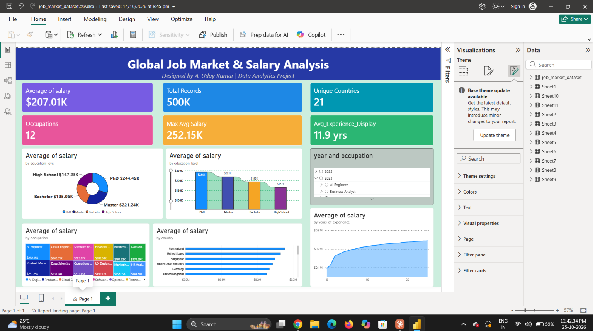

# Global Job Market Analysis and Salary Insights Dashboard

An end-to-end data analytics project: raw job market data → data quality checks → SQL and Python analysis → interactive Power BI dashboard → salary insights.

> **Note:** the dataset is synthetic and does not represent actual employee payroll records.

**Tools:** Python (Pandas, Matplotlib), SQL (MySQL), Excel (pivot tables), Power BI (DAX, interactive dashboard).

---

## Project Overview
This project analyzes a global job market dataset containing 499,972 records to explore salary patterns across occupations, countries, education levels, years of experience, and employment types.

The project uses Excel, SQL, Power BI, and Python to perform data analysis and present insights.

## Business Questions
1. Which occupations and countries have the highest average salaries?
2. How does salary change with years of experience?
3. How does education level affect average salary?
4. How are job records distributed across 2022–2025?

## Tools and Technologies
- **Excel:** Data exploration and pivot-table analysis
- **MySQL:** SQL queries and salary analysis
- **Power BI:** Interactive dashboard and data visualization
- **Python:** Data analysis using Pandas and Matplotlib

## Dataset
- Records: 499,972
- Columns: 12
- Coverage: 2022–2025
- Data quality checks: No missing values and no duplicate records found

## Key Analysis
- Average salary by occupation
- Average salary by country
- Average salary by years of experience
- Average salary by education level
- Job record distribution by year
- Data quality checks for missing and duplicate records

## Dashboard
Interactive Power BI report built with DAX measures and slicers.

To explore it yourself, download `job_market_dataset.csv.xlsx.pbix` and open it in Power BI Desktop.

## Key Findings
- **AI Engineer** had the highest average salary among the occupations analyzed ([FILL: value]).
- **Switzerland** had the highest average salary among the countries analyzed ([FILL: value]).
- Average salary generally **increased with years of experience** in this dataset ([FILL: e.g. from X at 0-2 years to Y at 15+ years]).
- **PhD holders** had the highest average salary among the education groups analyzed ([FILL: value]).
- Job records were distributed relatively evenly across 2022–2025.

## Method Summary
1. Checked data quality: no missing values and no duplicate records.
2. Explored the data with Excel pivot tables.
3. Wrote SQL queries (`job_market_analysis.sql`) for salary analysis.
4. Used Python (Pandas, Matplotlib) in `job_market_eda.py` and exported results to CSV files.
5. Built an interactive Power BI dashboard.
6. Summarized the key findings.

## Project Files
- `job_market_dataset.csv`: Source dataset
- `job_market_analysis.sql`: SQL analysis queries
- `job_market_dataset.csv.xlsx`: Excel analysis (35 MB, too large for GitHub to preview, click **Download raw file** to open it)
- `job_market_dataset.csv.xlsx.pbix`: Power BI report
- `job_market_eda.py`: Python analysis script
- `Python_Analysis_Results/`: output files from the Python script (salary by occupation, country, experience, education, and job records by year)
- `job_market_dashboard_page1.png`, `job_market_dashboard_page2.png`: dashboard screenshots

## Disclaimer
The dataset is synthetic. Salary figures are reported as provided in the dataset; no currency is assumed. Findings describe patterns in this dataset and should not be interpreted as causal conclusions about the real-world job market.
